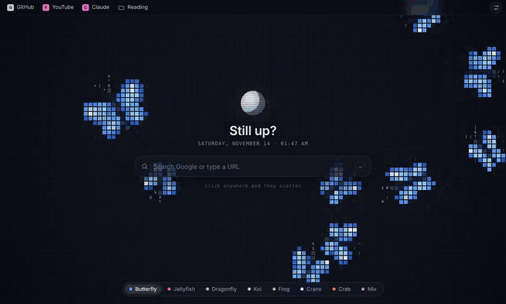
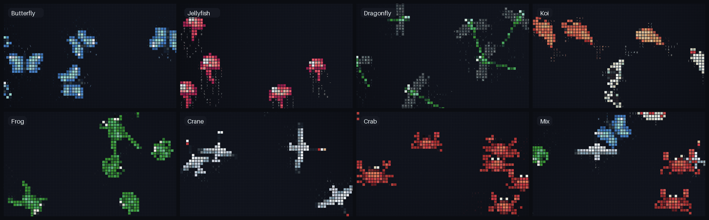
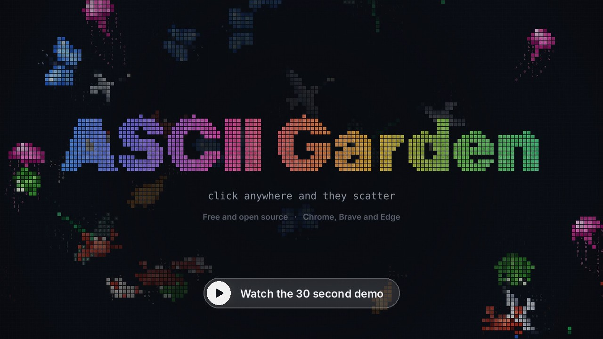
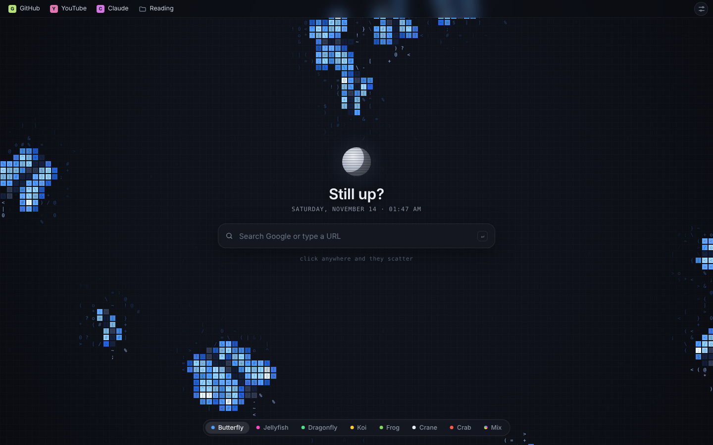

<div align="center">


# ASCII Garden

**A new tab page where little animals made of keyboard characters drift across your screen.**<br>
Click anywhere and they scatter.

[**Chrome Web Store**](https://chromewebstore.google.com/detail/ohapicmgbfnlnomnpoadjfegfffekcio) &nbsp;·&nbsp; [**Live demo**](https://themixa.github.io/ascii-garden/) &nbsp;·&nbsp; [**Download**](https://github.com/TheMixa/ascii-garden/raw/main/download/ascii-garden-extension.zip) &nbsp;·&nbsp; [Demo video](https://youtu.be/k8TQqjueMi8) &nbsp;·&nbsp; [How it works](#how-it-works)

[](https://chromewebstore.google.com/detail/ohapicmgbfnlnomnpoadjfegfffekcio)


<br>



</div>

<br>

## Features

- **Seven animals, plus Mix.** Butterflies flutter, jellyfish pulse, dragonflies dart and hover, koi swim, frogs hop, cranes glide and crabs scuttle sideways.
- **Click to scatter.** Every animal gets pushed away from the click and panics for a moment. They also stay shy of your cursor.
- **Character trails.** Everything leaves a fading wake of `$ { ) ~ #` behind it.
- **Your bookmarks bar**, with folders and an overflow menu. Browsers hide their own bar on custom new tab pages, so this one draws it for you.
- **A greeting that follows the clock**, from "Good morning" to "Still up?" at 3 am.
- **Search box** that uses your browser's own search engine, or goes straight to a site if you type a URL.
- **Settings** for your name, how many animals, trails and the bookmarks bar.
- **Tiny and private.** About 40 KB of plain JavaScript. No frameworks, no build step, no tracking, no network requests.

<p align="center">
  
</p>

## Demo video

<p align="center">
  <a href="https://youtu.be/k8TQqjueMi8">
    
  </a>
</p>

## Install

**Easiest:** install it from the [Chrome Web Store](https://chromewebstore.google.com/detail/ohapicmgbfnlnomnpoadjfegfffekcio). It works in Chrome, Brave and Edge.

**Or install it manually:**

1. Download **[`ascii-garden-extension.zip`](https://github.com/TheMixa/ascii-garden/raw/main/download/ascii-garden-extension.zip)** and unzip it.
2. Open `chrome://extensions` (or `brave://extensions`, `edge://extensions`).
3. Turn on **Developer mode**.
4. Click **Load unpacked** and pick the `ascii-garden-extension` folder.
5. Open a new tab.

You can also clone this repo and load the `extension/` folder directly.

<p align="center">
  
</p>

**Permissions:** `bookmarks` (read only, to draw your bookmarks bar), `favicon` (to show site icons next to them) and `search` (to send searches to your default search engine). Nothing ever leaves your computer. See the [privacy policy](PRIVACY.md).

## Keyboard

| Key | Action |
| --- | --- |
| `1` to `8` | Switch animal |
| `Esc` | Close menus and settings |

## How it works

The screen is a grid of cells. Every animal is a **shape function**: give it a point in the animal's own coordinates (`x` forward, `y` sideways, measured in cells) and it returns which palette colour sits there, or `0` for nothing.

```js
// a very simple fish: an oval body and a triangle tail
shape(x, y) {
  if ((x / 4) ** 2 + (y / 2) ** 2 < 1) return 1;            // body
  if (x < -3 && x > -6 && Math.abs(y) < -3 - x) return 2;    // tail
  return 0;
}
```

Each frame, every grid cell near an animal is rotated into that animal's frame and passed to its shape function. Filled cells are painted as coloured tiles with a random keyboard character inside. Sampling a rotated shape onto a fixed grid is what gives the chunky pixel look at any angle, and animation is just changing the shape's parameters: wings squash sideways to flap, the jellyfish bell contracts, the koi's body sways.

Cells an animal has just left keep a character that slowly fades, which makes the trails. A click gives every animal an outward push plus a `panic` value that speeds it up and wears off over a second or two.

## Add your own animal

Add an entry to `SPECIES` in [`extension/app.js`](extension/app.js) and put its key in `ORDER`:

```js
snail: {
  label: 'Snail', dot: '#c9a46b', count: 8, radius: 6, scale: [0.9, 1.2],
  palette: makePalette(['#6b4f2a', '#c9a46b', '#f1e3c6']),
  init(a)           { a.wander = Math.random() * Math.PI * 2; },
  update(a, dt, U)  { /* set a.vx, a.vy (pixels per second) and a.h (heading) */ },
  scatter(a, angle) { a.wander = angle; },
  shape(x, y, a)    { /* return a palette index, or 0 */ }
}
```

In a palette, `'g:#hex'` draws just a character with no tile (good for tentacles and fins) and `'a:#hex'` draws a see-through tile (dragonfly wings).

## Project layout

```
extension/   the extension: manifest, page, styles, script, icons
docs/        the live demo, built from extension/ and served by GitHub Pages
scripts/     build.py (demo page + zip) and make_icons.py
assets/      images for this README
store/       Chrome Web Store images and listing text
download/    the ready-to-install zip
```

Run `python3 scripts/build.py` to rebuild `docs/index.html` and `dist/ascii-garden-extension.zip` after changing anything in `extension/`, then copy the zip into `download/`.

## Credits

Inspired by a reel from **stephenz.mp4** on Instagram that showed ASCII animals living in a browser. This version is written from scratch.

## License

[MIT](LICENSE) © 2026 Mihailo Karić
